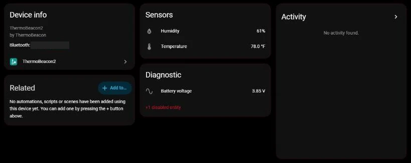

# ThermoBeacon2 for Home Assistant

A Home Assistant custom integration for Bluetooth temperature and humidity sensors that advertise under the name **ThermoBeacon2**.

Home Assistant's built-in ThermoBeacon integration does not recognise these sensors. The older models it supports put two extra bytes at the start of their broadcast; ThermoBeacon2 sensors leave them out, so the built-in parser rejects every broadcast. This integration reads the newer layout. It only listens to broadcasts, never connects to the sensor, and needs no cloud account or phone app.



## Supported sensors

A sensor is supported if its Bluetooth broadcast has all of these:

- the name `ThermoBeacon2`, or manufacturer id 25 (`0x0019`) together with service UUID `0xFFF0`
- a 20-byte manufacturer payload that starts with the sensor's own Bluetooth address

These are small battery-powered hygrometers with an LCD, sold under several brand names. If your sensor shows up in the built-in ThermoBeacon integration, use that one instead.

## Requirements

- Home Assistant 2025.2 or newer. The integration's icon is shown from Home Assistant 2026.3.
- The [Bluetooth integration](https://www.home-assistant.io/integrations/bluetooth/) set up with a Bluetooth adapter on the Home Assistant machine, or a Bluetooth proxy (for example an ESPHome device) within range of the sensors.

## Installation

### HACS

1. In HACS, open the menu and choose **Custom repositories**.
2. Add `https://github.com/OnticEntia/thermobeacon2` with the type **Integration**.
3. Search for **ThermoBeacon2**, download it, and restart Home Assistant.

### Manual

1. Copy the `custom_components/thermobeacon2` folder from this repository into the `custom_components` folder of your Home Assistant configuration directory.
2. Restart Home Assistant.

## Configuration

There is no YAML configuration.

- **Automatic discovery:** once a sensor is heard, it appears under **Settings > Devices & services** as a discovered device. Select **Add** and confirm.
- **Adding by hand:** go to **Settings > Devices & services > Add integration**, search for **ThermoBeacon2**, and pick the sensor from the list. The list shows only sensors that are currently being heard and are not yet added.

Each sensor is one device, named `ThermoBeacon2` followed by the last four characters of its Bluetooth address. You can rename it afterwards.

## Entities

| Entity | Unit | Notes |
| --- | --- | --- |
| Temperature | °C | Shown in your preferred unit by Home Assistant. |
| Humidity | % | Readings slightly over 100 % are shown as 100 %. |
| Battery voltage | V | Diagnostic. |
| Signal strength | dBm | Diagnostic. Disabled by default; enable it on the device page. |

The sensors broadcast every few seconds and the last digit flickers. To keep the history readable, a value is updated only once it has moved by at least 0.1 °C, 0.5 % humidity, 20 mV or 3 dBm.

A sensor becomes unavailable when Home Assistant has stopped hearing it, which can take several minutes after it goes out of range or its battery runs out.

## Troubleshooting

- **The sensor is not discovered.** Check that the Bluetooth integration is working and that the sensor is within range of an adapter or proxy. If the sensor is discovered by the built-in ThermoBeacon integration, it is an older model and does not need this one.
- **"No unconfigured ThermoBeacon2 devices were heard over Bluetooth".** No supported sensor has been heard recently. Move the sensor closer, check its battery, wait a minute and try again.
- **Entities are unavailable.** The sensor is out of range or its battery is empty. A falling battery voltage is an early sign.
- **Values seem to update slowly.** Small changes are ignored on purpose; see [Entities](#entities).
- **Something else.** Enable debug logging and open an [issue](https://github.com/OnticEntia/thermobeacon2/issues) with the log:

  ```yaml
  logger:
    logs:
      custom_components.thermobeacon2: debug
  ```

## Development

The broadcast parser and the update filter have no Home Assistant imports, so the tests need only Python:

```bash
python3 -m unittest discover -s tests
```

Run it from the repository root. Plain `python3 -m unittest` finds no tests.

## Licence

[MIT](LICENSE)
